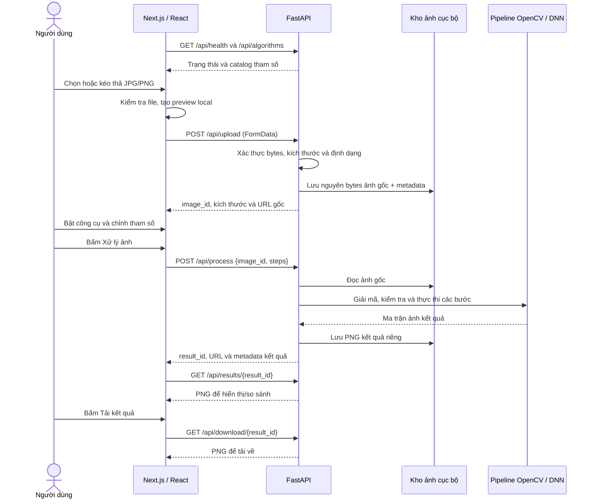

# Resim — nội dung thuyết trình ngày 06/11/2026

Tài liệu dùng để chuẩn bị slide, tập lời nói, mở code giải thích và demo trực tiếp. Nội dung mô tả mã nguồn hiện tại trong `backend/` và `frontend/`. Thời lượng gợi ý: 15–20 phút trình bày và 5 phút demo; nếu ít thời gian, dùng phần 1 rồi chọn nội dung ở các phần sau.

Lưu ý phạm vi: mã nguồn đã ghép đủ tám nhóm công cụ, tương ứng chín thuật toán vì khử nhiễu có hai phương pháp. AI tư vấn vẫn chưa triển khai. README và hợp đồng API còn một số mô tả phạm vi cũ chỉ gồm ba công cụ; cần thống nhất tài liệu trước khi tuyên bố nghiệm thu toàn bộ. Tài liệu này không thay đổi hợp đồng.

## 1. Dàn ý để đưa vào slide

| Slide | Nội dung chính | Câu dẫn có thể nói |
|---|---|---|
| 1 | Tên đề tài, vấn đề ảnh cũ | “Resim hỗ trợ cải thiện ảnh gặp nhiễu, thiếu sáng, tương phản thấp, xước, ám vàng hoặc cần tô màu, phóng lớn.” |
| 2 | Kiến trúc Next.js + FastAPI | “Giao diện quản lý thao tác và xem ảnh; máy chủ thực hiện thuật toán rồi trả ảnh kết quả thật.” |
| 3 | Luồng upload → cấu hình → xử lý → so sánh → tải | “Upload chỉ lưu ảnh gốc. Thuật toán chỉ chạy khi người dùng bấm Xử lý ảnh.” |
| 4 | Pipeline và quy ước dữ liệu | “Mỗi lần xử lý bắt đầu từ ảnh gốc, chỉ chạy các công cụ đang bật, phóng ảnh đứng cuối.” |
| 5 | Khử nhiễu Median/Bilateral | “Median phù hợp nhiễu muối tiêu; Bilateral giảm nhiễu đồng thời hạn chế làm mờ biên.” |
| 6 | Gamma | “Nhóm dùng quy ước gamma lớn hơn 1 làm ảnh sáng hơn.” |
| 7 | CLAHE | “Tăng tương phản cục bộ trên kênh độ sáng L, có giới hạn khuếch đại histogram.” |
| 8 | Unsharp Mask | “Lấy ảnh trừ bản làm mờ để lấy thành phần chi tiết, sau đó cộng trở lại có trọng số.” |
| 9 | Giảm vết xước | “Tạo mask tự động bằng hình thái học, rồi dùng Telea để điền vùng được phát hiện.” |
| 10 | Giảm ố vàng | “Ước lượng ám vàng toàn ảnh trong Lab và giảm thành phần b* dương.” |
| 11 | Tô màu ECCV16 | “Mô hình dự đoán hai kênh màu a*, b* từ độ sáng; màu thu được là dự đoán.” |
| 12 | Phóng ảnh Lanczos | “Tăng mỗi chiều 2 hoặc 4 lần bằng nội suy; đây chưa phải AI super-resolution.” |
| 13 | Các thao tác hỗ trợ | “Hoàn tác và đặt lại tác động tới cấu hình; so sánh và tải chỉ mở khi đã có kết quả thật.” |
| 14 | Demo | “Chọn các công cụ phù hợp với từng ảnh, thay vì mặc định bật tất cả.” |
| 15 | Kiểm thử và giới hạn | “Test xác nhận hành vi và luồng xử lý; chất lượng trên ảnh cũ thực tế còn phụ thuộc mức hư hại và tham số.” |

## 2. Lời mở đầu và mục tiêu

**Lời nói gợi ý:**

> Kính chào thầy/cô và các bạn. Nhóm em giới thiệu Resim, một ứng dụng web hỗ trợ xử lý và cải thiện ảnh cũ. Người dùng tải ảnh lên, chọn công cụ, điều chỉnh tham số, xử lý trên máy chủ rồi xem và tải kết quả. Điểm nhóm tập trung là cho phép quan sát tác động của từng thuật toán, kết hợp chúng thành một pipeline và bảo toàn tệp ảnh gốc.

Các vấn đề và công cụ tương ứng:

| Vấn đề | Công cụ |
|---|---|
| Nhiễu muối tiêu hoặc nhiễu hạt | Median hoặc Bilateral |
| Ảnh tối/sáng chưa phù hợp | Gamma |
| Vùng ảnh nhạt, khó phân biệt chi tiết | CLAHE |
| Biên và chi tiết hơi mềm | Unsharp Mask |
| Đường xước mảnh sáng hoặc tối | Phát hiện mask + Telea inpainting |
| Ám vàng toàn ảnh | Hiệu chỉnh Lab |
| Ảnh đen trắng cần màu tham khảo | ECCV16 colorization |
| Cần kích thước ảnh lớn hơn | Lanczos 2×/4× |

Không cam kết lấy lại chính xác màu lịch sử, chi tiết đã mất hoặc sửa mọi dạng hư hại.

## 3. Ứng dụng chạy như thế nào?

### 3.1. Các thành phần

| Thành phần | Công nghệ | Trách nhiệm |
|---|---|---|
| Frontend | Next.js, React, TypeScript, Tailwind CSS | Upload, hiển thị preview, dựng controls, giữ cấu hình, gọi API, so sánh và tải |
| Backend | FastAPI, Pydantic | Tiếp nhận request, kiểm tra dữ liệu, điều phối xử lý, trả metadata và tệp ảnh |
| Xử lý ảnh | OpenCV, NumPy | Lọc, biến đổi màu/độ sáng, phát hiện xước, inpainting và nội suy |
| Đọc/ghi ảnh | Pillow | Xác thực JPEG/PNG, áp hướng EXIF trên bản giải mã, đóng gói PNG và giữ alpha |
| Tô màu | ECCV16 qua OpenCV DNN CPU | Dự đoán màu từ độ sáng, dùng trọng số lưu cục bộ |
| Lưu trữ | Filesystem + metadata JSON | Lưu ảnh gốc và kết quả riêng theo UUID, TTL mặc định 24 giờ |

Next.js và FastAPI chạy ở hai tiến trình riêng. Frontend gọi trực tiếp backend theo `NEXT_PUBLIC_API_BASE_URL`; không có proxy API của Next.js trong luồng này. Việc xử lý hiện chạy trên CPU, không cần GPU hoặc API key.

### 3.2. Lệnh mở ứng dụng trên máy đã cài dependencies

Terminal 1, từ gốc repository:

```powershell
Set-Location C:\Users\Admin\Documents\GitHub\btl-xla-nhom5\backend
.\run.cmd
```

Terminal 2:

```powershell
Set-Location C:\Users\Admin\Documents\GitHub\btl-xla-nhom5\frontend
npm.cmd run dev
```

Mở [giao diện](http://localhost:3000), [health](http://127.0.0.1:8000/api/health) hoặc [Swagger API](http://127.0.0.1:8000/docs).

Nếu máy chưa có mô hình tô màu, chạy một lần trong `backend/` trước buổi demo:

```powershell
.\.venv\Scripts\python.exe scripts/download_colorization.py
```

Đây là bước chuẩn bị, không phải thao tác mỗi lần xử lý. Khi inference, ứng dụng đọc trọng số trên máy, không gọi dịch vụ AI bên ngoài.

### 3.3. Sơ đồ luồng tổng quát



## 4. Luồng code từ khi mở trang đến khi có kết quả

### 4.1. Frontend

1. `frontend/src/app/page.tsx` mở editor ngay tại `/`.
2. `Editor.tsx` gọi `connectToBackend()`, lấy health và catalog song song.
3. `ToolsPanel.tsx` dựng thanh trượt, ô số và lựa chọn từ catalog. Default/range/options đến từ backend.
4. `acceptFile()` gọi `validateAndDecodeImage()`; hợp lệ thì tạo object URL cho preview và gọi `uploadFile()`.
5. `editorReducer()` giữ trạng thái file, upload, catalog, cấu hình, lịch sử, request và kết quả.
6. `processImage()` gọi `serializeSteps()`, sau đó gửi request qua `apiClient.process()`.
7. Nhận kết quả hợp lệ thì dispatch `PROCESS_SUCCEEDED` và chuyển sang chế độ xem kết quả.
8. `Canvas.tsx` hiển thị ảnh gốc/kết quả/so sánh; `downloadResult()` tải tệp thật từ backend.

**Điểm cần nói:** thay đổi thanh trượt chỉ thay cấu hình. Ảnh chỉ được xử lý khi bấm nút; preview không dùng CSS filter để mô phỏng thuật toán.

### 4.2. Backend

1. `app/main.py`: tạo app, cấu hình CORS, lỗi, hai kho ảnh và khóa xử lý.
2. `app/api/routes.py`: tiếp nhận HTTP, tìm ảnh theo ID, gọi service tương ứng.
3. `app/schemas/models.py`: kiểm tra schema bằng Pydantic; chặn trường lạ, tham số sai kiểu, bước trùng và upscale không ở cuối.
4. `app/catalog.py`: định nghĩa thuật toán, tham số, giới hạn và defaults dùng chung cho catalog và validation.
5. `app/services/processing.py:create_result()`: đọc ảnh gốc, áp EXIF orientation trên bản giải mã, tách alpha, đổi RGB sang BGR.
6. `app/pipeline.py:process_image()`: kiểm tra toàn bộ bước và pixel budget, chạy lần lượt các hàm đã đăng ký.
7. Service đổi BGR về RGB, gắn lại alpha nếu có, mã hóa PNG và lưu kết quả riêng.

Ảnh thuật toán là NumPy array `uint8`, dạng `(height, width, 3)`, thứ tự kênh **BGR**, giá trị 0–255. Khi tính toán có nguy cơ tràn số, code chuyển sang float rồi giới hạn về 0–255 trước khi trả `uint8`.

### 4.3. Thứ tự pipeline

```text
Ảnh gốc
  → Giảm xước
  → Khử nhiễu
  → Giảm ám vàng
  → Gamma
  → CLAHE
  → Tô màu
  → Làm nét
  → Phóng ảnh
  → PNG kết quả
```

Chỉ công cụ đang bật mới có mặt. Median và Bilateral là hai lựa chọn của cùng nhóm nên không chạy đồng thời trong một request.

Thứ tự trên do frontend tạo trong `TOOL_ORDER` của `serialization.ts`; backend giữ thứ tự request và bắt buộc upscale cuối. Không nói backend tự sắp xếp toàn bộ bước.

Lý do lựa chọn: giảm hư hại và nhiễu trước khi tăng tương phản/làm nét để hạn chế khuếch đại chúng; hiệu chỉnh ám màu trước các bước màu sau; upscale cuối để các bước trước làm việc trên ảnh nhỏ hơn. Đây là lựa chọn của ứng dụng, không phải thứ tự tối ưu tuyệt đối cho mọi ảnh.

Đoạn code cốt lõi, trích rút gọn từ `process_image()`:

```python
prepared = prepare_steps(steps)
check_output_size(original.shape[1], original.shape[0], prepared, max_result_pixels)
current = original.copy()
for step in prepared:
    function = IMPLEMENTED_ALGORITHMS[step["algorithm"]]
    if step["algorithm"] == "colorize_image":
        current = function(current, step["params"], model_dir=model_dir)
    else:
        current = function(current, step["params"])
return current
```

**Lời nói:** “Đầu ra của bước trước trở thành đầu vào của bước sau. Tuy nhiên, khi bấm xử lý lần tiếp theo, hệ thống lại đọc ảnh gốc và chạy cấu hình mới, tránh cộng dồn xử lý ngoài ý muốn.”

## 5. Khử nhiễu — Median và Bilateral

**File:** `backend/app/algorithms/denoise.py`.

### 5.1. Median — lọc trung vị

Với từng vị trí, lấy các giá trị trong cửa sổ lân cận, sắp xếp và chọn trung vị thay cho giá trị hiện tại. OpenCV thực hiện trên từng kênh màu. Ví dụ chín giá trị gồm tám số 100 và một số 255: trung vị vẫn là 100, nên điểm nhiễu sáng bị loại.

```python
return cv2.medianBlur(image, ksize=int(config["kernel_size"]))
```

| Tham số | Giá trị | Ý nghĩa |
|---|---|---|
| `kernel_size` | 3, 5, 7; mặc định 3 | Cạnh cửa sổ vuông, tương ứng 3×3, 5×5, 7×7 pixel. Cửa sổ lớn lọc mạnh hơn nhưng dễ mất chi tiết nhỏ. |

Phù hợp nhiễu muối tiêu, điểm trắng/đen rời rạc. Không khẳng định Median giữ mọi biên hoặc chi tiết.

### 5.2. Bilateral — lọc song phương

Thay pixel bằng trung bình có trọng số của lân cận. Trọng số xét cả khoảng cách không gian và độ khác biệt màu: pixel gần, màu giống nhau có ảnh hưởng lớn; pixel ở phía bên kia một biên màu thường có ảnh hưởng nhỏ hơn.

```python
return cv2.bilateralFilter(
    image,
    d=int(config["diameter"]),
    sigmaColor=float(config["sigma_color"]),
    sigmaSpace=float(config["sigma_space"]),
    borderType=cv2.BORDER_REFLECT_101,
)
```

| Tham số | Range / mặc định / bước UI | Ý nghĩa |
|---|---|---|
| `diameter` | 5, 7, 9 / 5 | Đường kính lân cận lọc. Lớn hơn xét nhiều pixel và tốn tính toán hơn. |
| `sigma_color` | 1–150 / 50 / 1 | Mức chênh lệch màu được chấp nhận khi trộn. Tăng lên làm mượt mạnh hơn giữa các màu khác nhau, có thể mất chi tiết. |
| `sigma_space` | 1–150 / 50 / 1 | Mức ảnh hưởng theo khoảng cách. Tăng lên làm trọng số giảm chậm hơn theo khoảng cách, nhưng phạm vi thực tế vẫn bị giới hạn bởi `diameter`. |

`BORDER_REFLECT_101` xử lý vùng biên bằng cách phản chiếu dữ liệu. Bilateral phù hợp nhiễu nhẹ trong vùng tương đối phẳng, cần hạn chế mờ biên.

**Câu nói ngắn:** “Median chọn trung vị để loại điểm nhiễu đột biến; Bilateral lấy trung bình có trọng số theo cả khoảng cách và màu.”

## 6. Điều chỉnh độ sáng — Gamma

**File/hàm:** `backend/app/algorithms/brightness.py:adjust_gamma()`.

Công thức với đầu vào chuẩn hóa `x = I/255`:

```text
y = x^(1/gamma)
O = round(255 × y)
```

```python
normalized = image.astype(np.float32) / 255.0
corrected = np.power(normalized, 1.0 / gamma) * 255.0
return np.clip(np.rint(corrected), 0, 255).astype(np.uint8)
```

| Tham số | Range | Mặc định | Bước UI | Tác động |
|---|---|---|---|---|
| `gamma` | 0.1–3 | 1 | 0.05 | >1 làm sáng; <1 làm tối; =1 giữ nguyên pixel |

Ví dụ pixel 64: gamma=2 cho giá trị xấp xỉ 128; gamma=0.5 cho khoảng 16. Mức đen 0 và trắng 255 được giữ ở hai đầu. Code áp cùng phép biến đổi lên các kênh BGR.

**Câu nói:** “Gamma điều chỉnh phi tuyến, tác động rõ ở vùng trung gian. Nó không đơn thuần cộng cùng một số vào mọi pixel, cũng không lấy lại chi tiết đã mất vì cháy sáng.”

## 7. Tăng tương phản — CLAHE

**File/hàm:** `backend/app/algorithms/contrast.py:enhance_clahe()`.

CLAHE là Contrast Limited Adaptive Histogram Equalization: cân bằng histogram thích nghi có giới hạn tương phản.

1. Đổi BGR sang Lab.
2. Tách L — độ sáng, a — trục màu xanh lá/đỏ, b — trục xanh dương/vàng.
3. Chạy CLAHE trên L để tăng tương phản từng vùng.
4. Ghép L mới với a, b cũ, rồi đổi về BGR.

```python
clahe = cv2.createCLAHE(
    clipLimit=float(config["clip_limit"]),
    tileGridSize=(grid_size, grid_size),
)
enhanced_lightness = clahe.apply(lightness)
```

| Tham số | Range / mặc định / bước UI | Ý nghĩa |
|---|---|---|
| `clip_limit` | 0.1–10 / 2 / 0.1 | Điều khiển giới hạn histogram trước phân phối lại. Tăng thường cho tương phản mạnh hơn nhưng có thể làm nhiễu nổi rõ. Không phải phần trăm. |
| `tile_grid_size` | Số nguyên 2–16 / 8 / 1 | Số ô trên **mỗi chiều**. Giá trị 8 tạo lưới 8×8, không phải cửa sổ 8×8 pixel. Nhiều ô hơn xử lý cục bộ trên vùng nhỏ hơn. |

**Câu nói:** “CLAHE phù hợp ảnh có tương phản thấp theo từng vùng. Nhóm chỉ xử lý L để hạn chế biến đổi màu trực tiếp; chuyển đổi qua lại và clipping vẫn có thể gây sai khác màu nhỏ.”

## 8. Làm sắc nét — Unsharp Mask

**File/hàm:** `backend/app/algorithms/sharpen.py:sharpen_unsharp()`.

```text
B = GaussianBlur(I, sigma)
D = I - B
O = I + amount × D
```

Làm mờ Gaussian tạo bản ít chi tiết tần số cao. Hiệu giữa ảnh và bản mờ biểu diễn thành phần chi tiết; cộng lại làm biên rõ hơn.

```python
source = image.astype(np.float32)
blurred = cv2.GaussianBlur(source, (0, 0), float(config["sigma"]),
                           borderType=cv2.BORDER_REFLECT_101)
return np.clip(np.rint(source + amount * (source - blurred)), 0, 255).astype(np.uint8)
```

| Tham số | Range / mặc định / bước UI | Ý nghĩa |
|---|---|---|
| `amount` | 0–3 / 0.8 / 0.05 | Hệ số khuếch đại phần chi tiết. 0 giữ nguyên; tăng lên làm nét mạnh hơn, dễ sinh viền và tăng nhiễu. |
| `sigma` | 0.1–5 / 1 / 0.1 | Độ lệch chuẩn Gaussian, theo đơn vị pixel. Điều khiển độ rộng vùng làm mờ và quy mô chi tiết được nhấn mạnh. |

`(0, 0)` để OpenCV xác định kích thước kernel từ sigma. Float32 tránh tràn số khi trừ/cộng; `clip` đưa kết quả về khoảng hợp lệ.

**Câu nói:** “Làm nét tăng độ rõ của chi tiết sẵn có; không tái tạo chắc chắn các chi tiết đã biến mất. Vì có thể tăng nhiễu, nhóm đặt khử nhiễu trước làm nét.”

## 9. Giảm vết xước — morphology + Telea

**File/hàm:** `backend/app/algorithms/scratches.py`, `detect_scratches()` và `reduce_scratches()`.

Có hai giai đoạn: xác định vùng nghi xước bằng mask, sau đó điền vùng mask.

### 9.1. Phát hiện mask

1. Chuyển BGR sang xám và Median 3×3 để hạn chế nhiễu nhỏ.
2. Dùng kernel ellipse 7×7 cho top-hat và black-hat.
3. Top-hat lấy cấu trúc sáng nhỏ: `gray - opening(gray)`; black-hat lấy cấu trúc tối nhỏ: `closing(gray) - gray`.
4. Ngưỡng hóa riêng hai loại với `threshold = 60 - 45 × sensitivity`.
5. Opening theo bốn hướng: ngang, dọc và hai đường chéo, với kernel dài 9 pixel.
6. Tìm thành phần liên thông; lọc theo kích thước, độ mảnh và diện tích.
7. Gộp mask, dilation bằng ellipse 3×3 để mở rộng vùng cần sửa quanh cấu trúc phát hiện.

Mask đầu ra là ảnh `uint8` cùng chiều cao/rộng: 0 là vùng giữ lại, 255 là vùng cần điền. `sensitivity=0` trả mask rỗng; ảnh có cạnh nhỏ hơn 9 pixel cũng không phát hiện.

### 9.2. Điền ảnh

```python
mask = detect_scratches(image, config)
if not np.any(mask):
    return image.copy()
return cv2.inpaint(image, mask, float(config["inpaint_radius"]), cv2.INPAINT_TELEA)
```

Telea dùng thông tin lân cận quanh vùng thiếu để ước lượng giá trị điền. Hàm nhận mask do backend tạo, frontend không gửi mask thủ công. Pixel ngoài mask được giữ nguyên.

| Tham số | Range / mặc định / bước UI | Ý nghĩa |
|---|---|---|
| `sensitivity` | 0–1 / 0.5 / 0.05 | Độ nhạy phát hiện. 0 tắt; tăng làm ngưỡng thấp hơn và nhận thêm ứng viên. 0.5 tương ứng ngưỡng 37.5 mức xám; 1 tương ứng 15. |
| `inpaint_radius` | Số nguyên 1–10 / 3 / 1 | Bán kính lân cận để nội suy, đơn vị pixel. Không phải độ rộng vết xước cần phát hiện. Tăng có thể làm vùng điền mượt hơn nhưng mất chi tiết. |

**Giới hạn cần nói:** bộ phát hiện dùng quy tắc hình dạng, không hiểu ngữ nghĩa. Tập trung vào đường mảnh, tương đối thẳng; có thể bỏ sót xước cong/rộng/ngắn và nhận nhầm tóc, dây hoặc hoa văn. Kiểm thử xước nhân tạo không đủ chứng minh độ chính xác trên mọi ảnh thật.

## 10. Giảm ố vàng — hiệu chỉnh ám màu toàn ảnh trong Lab

**File/hàm:** `backend/app/algorithms/yellowing.py:remove_yellow_cast()`.

Code xử lý ám vàng toàn ảnh, chưa tách từng đốm/vết ố cục bộ.

1. Chuẩn hóa BGR về float 0–1, chuyển sang Lab.
2. Chọn pixel sáng có màu không quá bão hòa: L từ mức lớn hơn giữa 15 và phân vị 60% của L; chroma `sqrt(a²+b²) < 60`.
3. Ước lượng ám vàng bằng trung vị b của tập ứng viên; giới hạn trong 0–35 đơn vị Lab.
4. Không có ứng viên hoặc ám vàng dưới 0.5 thì trả bản sao nguyên pixel.
5. Giảm b theo ước lượng; nhân thêm hệ số `clip(L/25, 0, 1)` để giảm tác động vào vùng tối.
6. Đổi về BGR và trộn với đầu vào bằng `strength`.

```python
lab[:, :, 2] -= cast * np.clip(lightness / 25, 0, 1)
corrected = cv2.cvtColor(lab, cv2.COLOR_Lab2BGR) * 255
blended = image.astype(np.float32) * (1 - strength) + corrected * strength
```

| Tham số | Range | Mặc định | Bước UI | Ý nghĩa |
|---|---|---|---|---|
| `strength` | 0–1 | 0.5 | 0.05 | 0 giữ nguyên; 1 dùng đầy đủ kết quả hiệu chỉnh; giá trị giữa trộn ảnh đầu vào và ảnh hiệu chỉnh |

**Câu nói:** “Trong Lab, b dương nghiêng về vàng. Nhóm ước lượng độ ám từ vùng sáng tương đối trung tính rồi giảm b. Nếu vật thể vốn có màu vàng hoặc ánh sáng ấm có chủ đích, thuật toán có thể hiệu chỉnh quá mức, nên có thanh cường độ.”

Không mô tả đây là khả năng tự phân biệt màu vàng thật với giấy cũ. Các giá trị 15, 60%, 35, 25 là hằng số nội bộ, không phải tham số người dùng chỉnh.

## 11. Tô màu — ECCV16 qua OpenCV DNN

**File/hàm:** `backend/app/algorithms/colorize.py:colorize_image()` và `_load_network()`.

Nguyên lý tích hợp: dùng độ sáng để dự đoán màu. Mô hình đã huấn luyện sẵn; dự án nạp và chạy inference, không huấn luyện lại mô hình.

1. `strength=0` trả bản sao đầu vào ngay, không cần trọng số.
2. Chuẩn hóa BGR về 0–1 và lấy L ở độ phân giải ảnh đầu vào.
3. Resize bản dùng cho mô hình về 224×224, chuyển Lab, lấy L rồi trừ 50.
4. `blobFromImage()` đóng gói đầu vào; `network.forward()` suy luận hai kênh a, b.
5. Resize a, b dự đoán về kích thước đầu vào, ghép với L đã giữ lại.
6. Chuyển Lab về BGR, giới hạn khoảng hợp lệ và trộn theo `strength`.

```python
network.setInput(cv2.dnn.blobFromImage(network_input))
chroma = network.forward()[0].transpose(1, 2, 0).copy()
chroma = cv2.resize(chroma, (image.shape[1], image.shape[0]))
lab = np.dstack((lightness, chroma)).astype(np.float32)
```

| Tham số | Range | Mặc định | Bước UI | Ý nghĩa |
|---|---|---|---|---|
| `strength` | 0–1 | 1 | 0.05 | Mức trộn ảnh đầu vào với kết quả mô hình. 0 giữ nguyên; 1 dùng toàn bộ kết quả. Không phải độ tin cậy hoặc tham số huấn luyện. |

Ba tệp cần thiết:

- `colorization_deploy_v2.prototxt`: mô tả mạng.
- `colorization_release_v2.caffemodel`: trọng số đã huấn luyện.
- `pts_in_hull.npy`: 313 tâm màu a/b dùng khi cấu hình đầu ra của mạng.

`_load_network()` cache mạng và nhận biết tệp thay đổi qua đường dẫn/thời gian sửa/kích thước. Lock bảo vệ cặp `setInput()/forward()` vì mạng cache có trạng thái mutable. Thiếu hoặc hỏng tệp trả `503 MODEL_UNAVAILABLE`, không trả ảnh giả thành công.

**Câu nói:** “AI ở đây là mô hình tô màu ECCV16 chạy cục bộ. Màu hợp lý về mặt dự đoán không đồng nghĩa đúng màu lịch sử; ảnh đã có màu có thể bị thay màu khi bật công cụ này.”

## 12. Nâng độ phân giải — nội suy Lanczos

**File/hàm:** `backend/app/algorithms/upscale.py:upscale_image()`.

```python
height, width = image.shape[:2]
return cv2.resize(
    image, (width * scale, height * scale),
    interpolation=cv2.INTER_LANCZOS4,
)
```

Lanczos nội suy giá trị pixel mới từ các pixel lân cận bằng kernel dựa trên hàm sinc có cửa sổ. Code dùng phương thức `INTER_LANCZOS4` của OpenCV.

| Tham số | Giá trị | Mặc định | Ý nghĩa |
|---|---|---|---|
| `scale` | 2 hoặc 4 | 2 | Nhân cả chiều rộng lẫn chiều cao; số pixel tăng tương ứng 4 hoặc 16 lần |

Ví dụ ảnh 1000×750: 2× thành 2000×1500; 4× thành 4000×3000. Số 4 trong tên `INTER_LANCZOS4` chỉ biến thể nội suy của OpenCV, không có nghĩa ứng dụng luôn phóng 4×.

Giới hạn đầu ra mặc định 32 triệu pixel được kiểm tra trước khi cấp phát ảnh lớn. Ảnh 1920×1080 phóng 4× tạo 7680×4320 = 33.177.600 pixel nên bị từ chối với `422 IMAGE_TOO_LARGE`; 2× vẫn trong giới hạn.

**Câu nói:** “Độ phân giải kích thước tăng, nhưng không đảm bảo độ chi tiết thật tăng tương ứng. Chức năng hiện tại dùng nội suy truyền thống, chưa dùng mạng AI super-resolution.”

## 13. Các chức năng hỗ trợ và cách code hoạt động

### 13.1. Tải ảnh lên và đổi ảnh

**File:** `Editor.tsx`, `image-validation.ts`, `api-client.ts`, `routes.py`, `image_storage.py`.

- Chọn từ file picker hoặc kéo thả đúng một ảnh JPG/PNG.
- Frontend kiểm tra file không rỗng, tối đa 10 MiB, chữ ký JPEG/PNG và khả năng giải mã; giới hạn 20 triệu pixel.
- Preview local dùng object URL, xuất hiện trước khi upload hoàn tất. Preview không đồng nghĩa backend đã nhận ảnh.
- `apiClient.upload()` gửi `FormData` có field `file`; browser tự tạo multipart boundary.
- Backend đọc có giới hạn, dùng Pillow kiểm tra nội dung, verify và decode, không chỉ tin extension/MIME.
- Sinh UUID4, lưu nguyên bytes gốc và metadata; trả `image_id`, filename, kích thước, dung lượng và URL.
- Controls chỉ mở khi upload thành công và catalog sẵn sàng.
- File mới không hợp lệ giữ ảnh đang có. Đổi sang file hợp lệ xóa cấu hình/lịch sử/kết quả cũ và đặt zoom về 1.
- Backend offline vẫn có thể xem local preview; xử lý cần upload thành công.

Code upload frontend:

```ts
const formData = new FormData();
formData.append("file", file, file.name);
```

**Chống response cũ:** khi đổi ảnh, `AbortController` hủy request phía client và tăng `generation`. Mọi response được kiểm tra generation trước khi ghi state để kết quả ảnh A không xuất hiện trên ảnh B. Hủy fetch không đảm bảo dừng phép tính đã bắt đầu ở backend.

Object URL cũ được revoke khi không còn dùng để giải phóng tài nguyên trình duyệt. Không lưu bytes ảnh vào localStorage.

### 13.2. Hoàn tác

**File:** `editor-state.ts:appendHistory()`, `UNDO_CONFIG`; phím tắt ở `Editor.tsx`.

Lịch sử chứa snapshot của **cấu hình**: công cụ bật/tắt, thuật toán đang chọn và giá trị tham số. Giới hạn tối đa 50 snapshot. Khi chỉnh mới sau khi undo, nhánh lịch sử phía sau bị bỏ; hiện không có giao diện redo.

```ts
const historyIndex = state.historyIndex - 1;
// Cấu hình được lấy từ state.history[historyIndex]
```

Hoàn tác giảm historyIndex và khôi phục cấu hình tương ứng. Kết quả hiện tại bị xóa khỏi state để không gắn ảnh cũ với thông số vừa khôi phục. Người dùng bấm xử lý lại để sinh kết quả theo cấu hình đó.

Ví dụ: gamma 1 → 1.2 → 1.5; bấm hoàn tác trở về 1.2. Đây không phải phục hồi một tệp ảnh kết quả trước đó. Thao tác không gọi API xử lý.

Một lần kéo slider cập nhật draft trong control; kết thúc kéo mới commit, tránh tạo hàng chục snapshot cho một cử chỉ. Có Ctrl+Z/Cmd+Z khi không nhập trong input/textarea/select; không cướp undo của ô đang gõ.

### 13.3. Đặt lại

**File:** `serialization.ts:createDefaultConfig()` và reducer `RESET_CONFIG`.

- Lấy giá trị mặc định từ catalog.
- Tắt tất cả tám nhóm.
- Chọn thuật toán đầu tiên của mỗi nhóm theo catalog; nhóm khử nhiễu về Median.
- Nếu cấu hình thay đổi, ghi cấu hình reset thành một bước lịch sử để có thể hoàn tác.
- Khi cấu hình thay đổi, xóa kết quả đang gắn trong state; giữ ảnh gốc đã upload.
- Không tải lại trang, không xóa tệp nguồn và không tự chạy thuật toán.
- Nút đặt lại cấu hình không đặt lại zoom; nút **Vừa khung** thực hiện việc đó.

| Thao tác | Đích đến | Có tự xử lý ảnh không? |
|---|---|---|
| Hoàn tác | Cấu hình trước trong lịch sử | Không |
| Đặt lại | Defaults từ catalog, tất cả công cụ tắt | Không |
| Đổi ảnh | Phiên ảnh mới, cấu hình/history/kết quả mới | Chỉ upload, chưa xử lý |
| Vừa khung | Zoom=1 và pan=(0,0) | Không |

### 13.4. So sánh trước–sau

**File:** `Canvas.tsx`.

Ba chế độ: **Gốc**, **So sánh**, **Kết quả**. Hai chế độ sau chỉ mở khi có `state.result` và URL kết quả.

- Ảnh gốc lấy từ local preview; ảnh kết quả lấy từ URL backend trả.
- Xếp hai ảnh trong cùng vùng hiển thị; ảnh kết quả ở lớp phía trên.
- Dùng CSS `clip-path` cắt phần lớp kết quả theo vị trí thanh trượt.
- Thanh trượt chạy từ 5% đến 95%, mặc định 50%; bên trái thấy ảnh gốc, bên phải thấy kết quả.
- Hai ảnh nhận cùng phép translate/scale để cùng zoom và pan. Upscale thay đổi số pixel nhưng vẫn được fit vào cùng vùng hiển thị.

```tsx
style={{ clipPath: `inset(0 0 0 ${comparePosition}%)` }}
```

**Câu nói:** “Thanh so sánh chỉ điều chỉnh phần nhìn thấy của hai ảnh thật, không trộn màu và không tạo một lần xử lý mới.”

Đây là so sánh hiển thị theo vùng fit, không phải phép đo chất lượng hoặc cam kết xem 1:1 từng pixel nguồn.

### 13.5. Tải ảnh kết quả về

**File:** `Editor.tsx:downloadResult()`, `api-client.ts:download()`, `routes.py:download()`.

1. Nút chỉ mở khi có result thật.
2. Frontend gửi `GET /api/download/{result_id}`.
3. Backend tìm trong kho kết quả, kiểm tra tồn tại và TTL; trả PNG với filename và header tải tệp.
4. Frontend nhận Blob, tạo object URL và thẻ `<a download>`, kích hoạt tải rồi revoke URL.

Tệp tên dạng `<tên-gốc>-ket-qua.png`. Dữ liệu PNG tải về là cùng kết quả dùng để xem trước ở endpoint results. PNG tránh thêm mất mát do nén JPEG ở bước xuất, nhưng không khôi phục thông tin vốn đã mất trong ảnh nguồn.

`result_id` khác `image_id`; không lấy ID ảnh gốc để giả thành kết quả. Đổi cấu hình làm result bị xóa khỏi state và nút tải khóa lại; tệp đã lưu trên backend không bị xóa ngay chỉ vì thao tác UI đó, mà chịu quản lý TTL.

### 13.6. Zoom, pan và vừa khung

- Zoom giới hạn 0.25–3, giao diện hiển thị 25%–300% so với mức fit.
- Nút cộng/trừ tăng/giảm 0.1; khi zoom >1 có thể kéo ảnh để pan.
- Vừa khung đưa zoom về 1 và pan về tâm.
- Dùng CSS transform để xem, không resize tệp, không thay đổi kích thước kết quả và không gọi pipeline.

### 13.7. AI tư vấn

Tab có giao diện và request API nhưng backend hiện trả `501 NOT_IMPLEMENTED`. Không dùng tab này để trình diễn lời khuyên AI đã hoạt động. Cần phân biệt nó với mô hình ECCV16: **tô màu AI đã chạy**, **AI tư vấn chưa chạy**.

## 14. API và cách giải thích payload

| Endpoint | Vai trò |
|---|---|
| `GET /api/health` | Kiểm tra backend |
| `GET /api/algorithms` | Catalog thuật toán và tham số |
| `POST /api/upload` | Lưu ảnh gốc, trả image_id |
| `GET /api/images/{image_id}` | Phục vụ nguyên bytes ảnh gốc |
| `POST /api/process` | Thực thi cấu hình trên ảnh gốc và lưu kết quả |
| `GET /api/results/{result_id}` | Hiển thị PNG kết quả |
| `GET /api/download/{result_id}` | Tải PNG kết quả |
| `POST /api/advise` | Điểm tích hợp AI tư vấn, hiện trả 501 |

Ví dụ payload để mở DevTools giải thích, UUID dưới đây chỉ minh họa cấu trúc; khi chạy phải dùng ID thật từ upload:

```json
{
  "image_id": "84e83523-9630-4de8-921e-daf875724d6d",
  "steps": [
    {
      "algorithm": "denoise_bilateral",
      "params": {"diameter": 5, "sigma_color": 50, "sigma_space": 50}
    },
    {"algorithm": "adjust_gamma", "params": {"gamma": 1.2}},
    {"algorithm": "upscale_image", "params": {"scale": 2}}
  ]
}
```

Giải thích: frontend không gửi lại toàn bộ ảnh trong mỗi lần xử lý; gửi ID để backend đọc ảnh gốc và danh sách bước cần chạy. Mỗi bước chứa algorithm ID và params dạng số JSON. Công cụ tắt không có mặt trong steps.

Backend chặn tham số chuỗi/boolean thay số, giá trị ngoài range, key lạ, lặp nhóm, đồng thời hai denoise hoặc upscale không cuối. Có 1–8 bước cho process; thiếu tham số đã biết được điền default. Bước slider là quy ước UI, backend không bắt mọi số phải là bội đúng của bước đó.

Các lỗi có thể giải thích khi demo: 413 quá dung lượng; 415 không phải JPEG/PNG hợp lệ; 422 sai tham số hoặc quá pixel; 404 không còn ảnh; 503 thiếu mô hình hoặc máy chủ bận. Mỗi tiến trình backend chỉ nhận một request xử lý tại một thời điểm, request xử lý khác nhận `PROCESSING_BUSY`; chưa có hàng đợi.

## 15. Kịch bản demo 5–7 phút

### Chuẩn bị trước khi lên trình bày

1. Chạy frontend/backend, kiểm tra health và catalog. Chuẩn bị model tô màu cục bộ.
2. Chuẩn bị ba loại ảnh thật: ảnh có nhiễu/thiếu sáng; ảnh có xước hoặc ám vàng; ảnh đen trắng. Chọn ảnh nhỏ vừa đủ để demo CPU nhanh, tránh phóng 4× vượt pixel budget.
3. Mở sẵn editor, thư mục tải xuống và các file code cần giải thích.
4. Có thể dùng kết quả đã tạo trước để dự phòng nhưng phải nói rõ là kết quả từ lần chạy trước; không trình bày như request vừa chạy thành công.

### Thao tác trực tiếp

| Bước | Thao tác | Điều cần nói |
|---|---|---|
| 1 | Upload ảnh nhiễu/thiếu sáng | “Preview xuất hiện ngay; trạng thái xác nhận khi backend đã lưu ảnh.” |
| 2 | Bật Bilateral và Gamma=1.2 | “Thông số đã đổi nhưng ảnh chưa đổi vì chưa bấm xử lý.” |
| 3 | Đổi Gamma=1.5, bấm hoàn tác | “Cấu hình trở lại 1.2; hoàn tác không gọi thuật toán.” |
| 4 | Bấm Xử lý ảnh | “Frontend gửi ID và các bước; backend xử lý từ ảnh gốc.” |
| 5 | Chuyển So sánh, kéo thanh trượt | “Hai lớp là ảnh gốc và PNG kết quả thật.” |
| 6 | Zoom và Vừa khung | “Đây là thao tác xem, không làm tăng số pixel của tệp.” |
| 7 | Tải kết quả và mở file | “Tệp PNG có metadata kích thước đúng với kết quả backend.” |
| 8 | Bấm Đặt lại rồi Hoàn tác | “Đặt lại tắt công cụ, khôi phục defaults; có thể hoàn tác cấu hình reset.” |
| 9 | Đổi ảnh đen trắng, bật Tô màu | “Màu do mô hình dự đoán; không phải màu lịch sử được xác minh.” |
| 10 | Nếu đủ thời gian, thử xước/ố vàng và upscale 2× | “Mỗi công cụ nên được chọn theo vấn đề thực tế của ảnh.” |

Không dùng một ảnh đã có màu, không có xước và không ám vàng để chứng minh cả tám chức năng cùng làm ảnh tốt hơn. Muốn chứng minh thuật toán nào, dùng ảnh thể hiện đúng vấn đề đó và so sánh riêng trước khi kết hợp.

## 16. Các file nên mở khi thầy/cô hỏi code

Các đường dẫn dưới đây tính từ gốc repository:

| Câu hỏi | File / hàm nên mở |
|---|---|
| State và các nút chạy như thế nào? | `frontend/src/features/editor/Editor.tsx` |
| Tham số và slider lấy từ đâu? | `backend/app/catalog.py`, `frontend/src/features/tools/ToolsPanel.tsx` |
| Thứ tự bước được quyết định ở đâu? | `frontend/src/features/editor/serialization.ts:serializeSteps()` |
| Hoàn tác/đặt lại lưu gì? | `frontend/src/features/editor/editor-state.ts` |
| So sánh ảnh làm như thế nào? | `frontend/src/features/editor/Canvas.tsx` |
| Gọi API ở đâu? | `frontend/src/services/api-client.ts` |
| Request xử lý vào backend ở đâu? | `backend/app/api/routes.py:process()` |
| Chặn tham số sai ở đâu? | `backend/app/schemas/models.py`, `backend/app/catalog.py` |
| Pipeline gọi các thuật toán thế nào? | `backend/app/pipeline.py:process_image()` |
| Đọc/ghi ảnh và giữ alpha ở đâu? | `backend/app/services/processing.py:create_result()` |
| Bảo toàn file gốc bằng cách nào? | `backend/app/services/image_storage.py`, kho kết quả riêng trong `main.py` |
| Công thức từng chức năng ở đâu? | `backend/app/algorithms/{denoise,brightness,contrast,sharpen,scratches,yellowing,colorize,upscale}.py` |
| Chứng minh kiểm thử? | `backend/tests/test_restoration.py`, `test_processing.py`, các test denoise/brightness/contrast và `frontend/src/features/editor/Editor.integration.test.tsx` |

## 17. Câu hỏi phản biện và cách trả lời

**Tại sao có tám chức năng nhưng chín thuật toán?**

Khử nhiễu có hai lựa chọn Median và Bilateral; mỗi lần chỉ chọn một. Bảy nhóm còn lại mỗi nhóm có một thuật toán.

**Vì sao dùng Lab cho CLAHE và giảm vàng?**

Lab tách độ sáng L khỏi hai trục màu a/b. CLAHE tác động vào L; giảm vàng chủ yếu tác động vào b. Cách này cho phép nhắm vào thành phần cần sửa, dù chuyển đổi màu và clipping vẫn có sai số.

**Gamma khác CLAHE thế nào?**

Gamma dùng một hàm ánh xạ độ sáng chung trên toàn ảnh. CLAHE điều chỉnh histogram theo vùng, tăng tương phản cục bộ. Hai chức năng không thay thế hoàn toàn nhau.

**Có phải thuật toán nào cũng phải làm pixel thay đổi?**

Không. Gamma=1, unsharp amount=0, strength=0 hoặc ảnh không có ám vàng/xước được phát hiện có thể trả pixel không đổi đúng thiết kế. Việc có thay đổi pixel cũng chưa chứng minh chất lượng tốt hơn.

**Tại sao không xử lý trên kết quả trước?**

Mỗi lần bắt đầu từ ảnh gốc giúp cấu hình mới có ý nghĩa nhất quán, tránh làm mờ/làm nét/nội suy cộng dồn không kiểm soát. Hệ thống hiện lưu lịch sử cấu hình, chưa quản lý cây phiên bản ảnh.

**Phóng 4× có tạo lại khuôn mặt hoặc chữ bị mất không?**

Không có bảo đảm đó. Lanczos nội suy pixel, chưa có mô hình phục hồi khuôn mặt hoặc AI super-resolution.

**Tô màu có đúng màu ban đầu không?**

Không xác định được từ ảnh đen trắng đơn lẻ. Mô hình dự đoán màu từ quy luật đã học; người dùng có thể giảm strength hoặc không bật công cụ.

**Vết xước có được phát hiện bằng deep learning không?**

Không. Bộ phát hiện hiện dùng morphology, threshold, cấu trúc định hướng và lọc hình dạng; sửa bằng Telea. Đây là phương pháp theo quy tắc, còn giới hạn với cảnh phức tạp.

**Hoàn tác và đặt lại có xóa ảnh gốc không?**

Không. Chúng thay đổi cấu hình frontend và bỏ liên kết kết quả hiện tại trong state khi cấu hình thay đổi. Bytes ảnh gốc được lưu riêng, không ghi đè.

**Có dùng AI không, tại sao tab AI chưa hoạt động?**

Có dùng mô hình ECCV16 cho tô màu. Tab AI tư vấn là tính năng khác, hiện mới có khung giao diện/API và trả 501.

**Đã chứng minh chất lượng đến mức nào?**

Kiểm thử hiện có kiểm tra hợp đồng dữ liệu, đặc tính trên ảnh tổng hợp, model thật và luồng HTTP/frontend. Chưa có bộ benchmark ảnh cũ đa dạng kèm ảnh sạch chuẩn và ngưỡng nghiệm thu cho từng chức năng; không suy diễn số test đạt thành mức chất lượng phục hồi.

## 18. Kiểm thử, giới hạn và lời kết

Trong lượt rà soát cùng cuộc trao đổi này, đã chạy:

```powershell
# Thư mục backend/
.\.venv\Scripts\python.exe -m pytest -q --tb=short --basetemp=.venv/test-temp-review-eight -o cache_dir=.venv/pytest-cache-review-eight

# Thư mục frontend/
npm.cmd test -- --run
```

Kết quả: **210 backend tests đạt, không skip; 26 frontend tests đạt**. Backend có một cảnh báo deprecation từ tương tác Starlette/httpx. Đây là kết quả của lượt rà soát trước khi soạn tài liệu; lượt soạn tài liệu không chỉnh code ứng dụng hoặc chạy lại lint/build/browser.

Giới hạn cần trình bày đúng: chất lượng tùy ảnh và tham số; xước là heuristic; giảm vàng toàn cục; màu là dự đoán; upscale là nội suy; CPU/mỗi tiến trình một request xử lý; kho tạm TTL 24 giờ; AI tư vấn chưa triển khai; tài liệu phạm vi cần đồng bộ.

**Lời kết gợi ý:**

> Nhóm đã xây dựng luồng từ upload đến xử lý, so sánh và tải kết quả, tích hợp tám nhóm công cụ với tham số điều chỉnh được. Ảnh gốc được giữ riêng, các bước chạy theo cấu hình rõ ràng và có kiểm thử. Hướng phát triển tiếp theo là đánh giá trên bộ ảnh cũ đa dạng, cải thiện phát hiện xước và xử lý ố cục bộ, rồi xem xét super-resolution và AI tư vấn.
